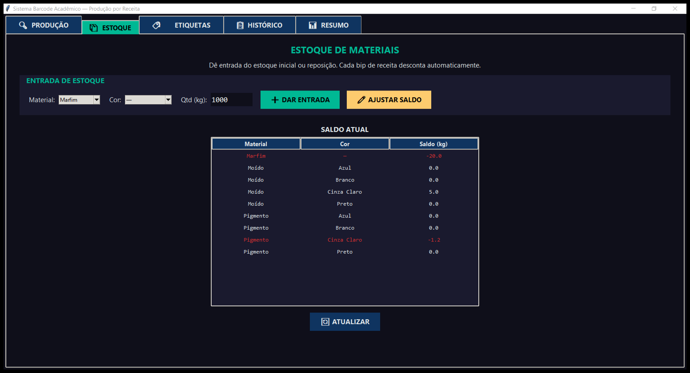
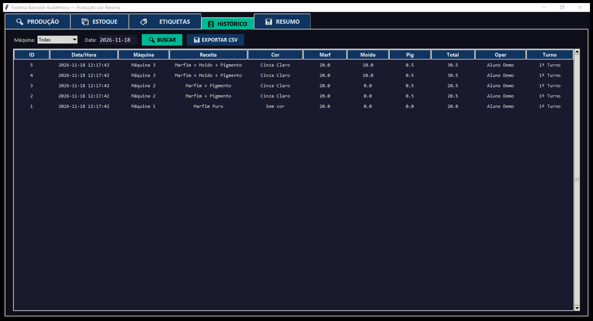
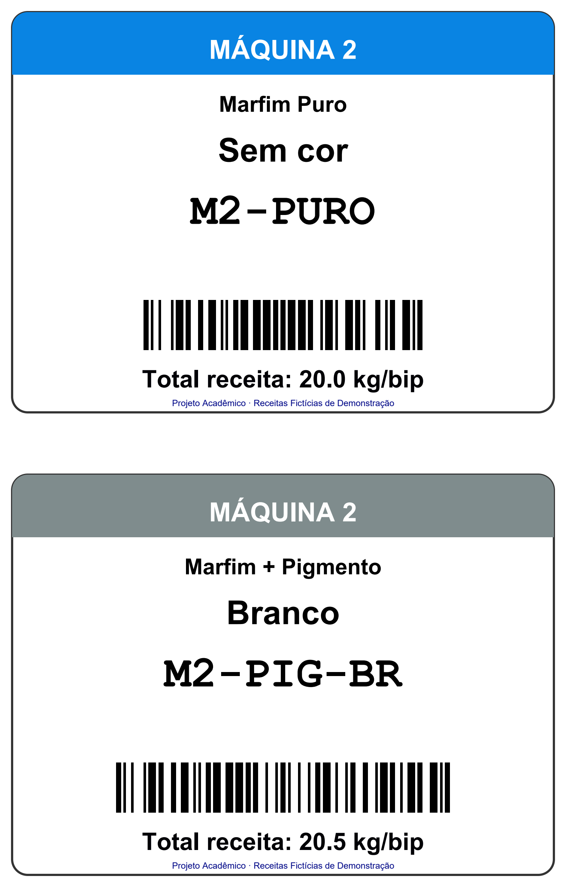
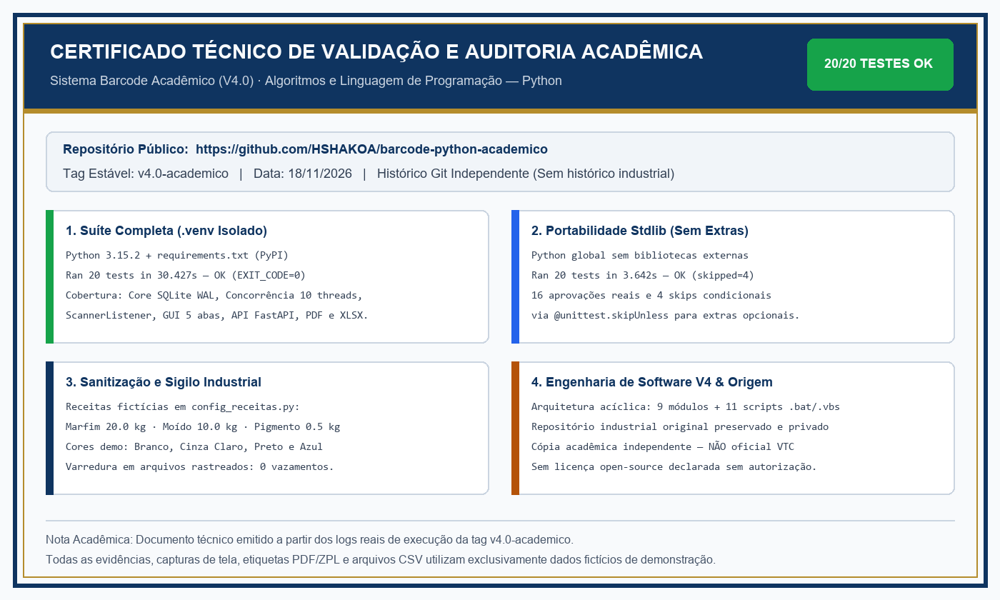

# Barcode Python Acadêmico (V4)

[](https://github.com/HSHAKOA/barcode-python-academico/actions/workflows/tests.yml)

-20%2F20%20OK-16A34A)


Cópia acadêmica independente em Python para apontamento de produção e controle de estoque por código de barras, estruturada para consulta e avaliação na disciplina **Algoritmos e Linguagem de Programação — Python**.

---

## Demonstração Animada do Fluxo Completo (Dados Fictícios)

<p align="center">
  
</p>

---

## Capturas Reais do Sistema em Execução

Todas as telas e etiquetas abaixo foram capturadas a partir de execução real isolada com receitas **estritamente fictícias** (`20,0 kg` base, `10,0 kg` de moído e `0,5 kg` de pigmento; operador `Aluno Demo`; entrada `NF-Ficticia-001`):

| Aba Produção (leitura `M3-MOI-CC`) | Aba Estoque (alerta saldo negativo) |
| :---: | :---: |
|  |  |

| Aba Histórico (5 apontamentos + CSV) | Aba Resumo do Dia (`122 kg` consolidado) |
| :---: | :---: |
|  |  |

<details>
<summary><b>Ver exemplo de etiqueta PDF Code 128 gerada via ReportLab (etiqueta_M2_p1.png)</b></summary>
<p align="center">
  
</p>
</details>

---

## Certificado Técnico de Validação e Auditoria Acadêmica

<p align="center">
  
</p>

- **Execução contínua (CI):** [`.github/workflows/tests.yml`](.github/workflows/tests.yml) executa automaticamente em `windows-latest` tanto a suíte completa (`20/20` com `requirements.txt`) quanto o modo somente biblioteca padrão (`16 OK, 4 skipped`).

---

## 1. Objetivo Acadêmico

Demonstrar, em um sistema real modularizado e testado, a aplicação prática de conceitos fundamentais de programação em Python: manipulação de strings, listas e dicionários, condicionais e laços, funções modulares, orientação a objetos, leitura/escrita de arquivos (CSV e ZPL), tratamento de exceções, concorrência com *threads* e filas, além de persistência transacional em SQLite.

---

## 2. Contexto do Problema Industrial

Em processos de extrusão de PVC, cada batelada preparada para alimentação das máquinas combina uma resina base (neste modelo didático chamada de *Marfim*) com adições opcionais de material moído (*Moído*) e corante (*Pigmento*) por cor. Sem apontamento eletrônico padronizado por leitura de código de barras, torna-se difícil rastrear o consumo previsto por máquina e turno ou antecipar quando determinado insumo entra em saldo negativo.

A aplicação resolve esse fluxo com etiquetas Code 128 no formato `{MAQUINA}-{RECEITA}` (ex.: `M2-PIG-CC`): uma leitura decodifica a receita, grava o apontamento no banco local e desconta os insumos previstos em uma única transação atômica.

> **Importante:** Todas as máquinas, cores e quantidades definidas em `PACOTE_MAQUINA_NOVA/config_receitas.py` nesta versão acadêmica são **estritamente fictícias e demonstrativas** (`20,0 kg` base, `10,0 kg` de moído e `0,5 kg` de pigmento), não expondo formulações nem dados operacionais reais de fábrica.

---

## 3. Tecnologias e Bibliotecas

### Biblioteca padrão do Python (nativa)
- `tkinter` / `tkinter.ttk`: interface gráfica desktop com 5 abas e tabelas `Treeview`.
- `sqlite3`: persistência relacional embarcada (`barcode_vtc.db`), modo `WAL` e transações `BEGIN IMMEDIATE`.
- `csv`: exportação tabular em UTF-8 BOM (`utf-8-sig`) com separador `;`.
- `threading` e `queue`: captura assíncrona em segundo plano e fila segura para a GUI.
- `math`, `datetime`, `time`, `os`, `contextlib`, `secrets`, `winsound`, `unittest`.

### Dependências externas (`PACOTE_MAQUINA_NOVA/requirements.txt`)
- `keyboard`: hook global de teclado em segundo plano (opcional; há fallback na janela Tkinter).
- `reportlab`: geração de etiquetas A4 em PDF com códigos de barras Code 128.
- `openpyxl`: criação da planilha base `.xlsx` com dashboard e abas para Power Query.
- `fastapi` e `uvicorn`: API HTTP local opcional protegida por `X-API-Key` (`VTC_API_KEY`).

---

## 4. Arquitetura e Módulos

```text
barcode-python-academico/
├── .github/
│   └── workflows/
│       └── tests.yml               # CI Windows: suíte completa (20/20) + modo stdlib
├── .gitignore
├── README.md
├── assets/
│   ├── demo_fluxo_academico.gif    # Animação do fluxo etiqueta -> leitura -> resumo
│   ├── certificado_validacao_v4.png# Certificado técnico de validação V4.0
│   ├── tela_01_producao.png        # Captura real da aba Produção (dados fictícios)
│   ├── tela_02_estoque.png         # Captura real da aba Estoque
│   ├── tela_03_historico.png       # Captura real da aba Histórico
│   ├── tela_04_resumo.png          # Captura real da aba Resumo do Dia
│   └── etiqueta_M2_p1.png          # Etiqueta PDF Code 128 renderizada (M2)
├── PACOTE_MAQUINA_NOVA/
│   ├── config_receitas.py          # Catálogo fictício demonstrativo (máquinas, cores e receitas)
│   ├── core_vtc.py                 # Decodificação, regras de estoque e persistência SQLite WAL
│   ├── etiquetas_vtc.py            # Geração de etiquetas PDF (Code 128) e ZPL
│   ├── scanner_vtc.py              # Captura HID em segundo plano + filtro temporal (0,8 s)
│   ├── barcode_vtc.py              # Interface gráfica Tkinter (5 abas) + fallback de teclado
│   ├── api_vtc.py                  # API FastAPI local opcional (127.0.0.1:8765)
│   ├── exportador_csv.py           # Exportador contínuo atômico (.tmp + os.replace) de 7 CSVs
│   ├── criar_planilha_pq.py        # Gerador da planilha RELATORIO_VTC_PQ.xlsx
│   ├── verificar_dados.py          # Relatório CLI rápido do SQLite
│   ├── requirements.txt            # Dependências PyPI
│   ├── COMO_CONFIGURAR_POWER_QUERY.md
│   └── [11 scripts Windows .bat/.vbs]
├── docs/                           # Documentação técnica detalhada
└── tests/
    └── test_barcode_regressao.py   # 20 testes automatizados isolados (unittest)
```

---

## 5. Instalação

Recomendado utilizar Python `3.10` a `3.15` com `tkinter` habilitado e ambiente virtual isolado:

```powershell
python -m venv .venv
.venv\Scripts\activate
pip install -r PACOTE_MAQUINA_NOVA\requirements.txt
```

*(O núcleo, a GUI em modo janela, o exportador CSV, a geração de ZPL e o verificador CLI também funcionam apenas com a biblioteca padrão do Python.)*

---

## 6. Execução

No diretório `PACOTE_MAQUINA_NOVA/`:

- **Interface gráfica principal:** `python barcode_vtc.py` (ou `INICIAR_VTC_BARCODE.bat`).
- **Exportador contínuo de CSVs:** `python exportador_csv.py` (ou `INICIAR_EXPORTADOR_CSV.bat`).
- **Gerador da planilha Power Query:** `python criar_planilha_pq.py`.
- **Verificador rápido no terminal:** `python verificar_dados.py` (ou `VERIFICAR_DADOS.bat`).
- **API HTTP local opcional (somente `127.0.0.1:8765`):**
  ```powershell
  $env:VTC_API_KEY="defina-uma-chave-forte-aqui"
  .\INICIAR_API_VTC.bat
  ```

---

## 7. Demonstração com Dados Fictícios

1. Inicie `python barcode_vtc.py` dentro de `PACOTE_MAQUINA_NOVA/` (criará um `barcode_vtc.db` local temporário e vazio).
2. Na aba **Estoque**, dê entrada fictícia de `40` kg de `Marfim` e `0.8` kg de `Pigmento` `Cinza Claro`.
3. Na aba **Produção**, informe `Aluno Demo` no campo `OPERADOR`, clique fora da caixa de texto e leia/digite rapidamente `M2-PIG-CC` + `Enter` (`20,0 + 0,5 = 20,5 kg`).
4. Repita `M2-PIG-CC` + `Enter` para observar a baixa para `0,0 kg` de Marfim e o alerta em vermelho de saldo negativo em `Pigmento Cinza Claro (-0.2 kg)`.

---

## 8. Como Executar os Testes

Na raiz do projeto:

```powershell
python -B -m unittest discover -s tests -v
```

Todos os 20 testes rodam exclusivamente em pastas temporárias (`tempfile.mkdtemp()`) com dados fictícios, cobrindo decodificação, transações/rollback, concorrência de 10 threads, `ScannerListener`, deduplicação GUI, navegação nas 5 abas, geração de PDF/ZPL/CSV/XLSX, API local e portabilidade dos 11 scripts Windows.

---

## 9. Limitações Conhecidas

- **Hardware físico:** leitor óptico USB HID e impressora térmica Zebra não são acionados fisicamente na suíte automatizada (o código ZPL é gerado e validado textualmente, e a captura é testada via hook/fila e eventos simulados).
- **Power Query no Excel:** a atualização automática periódica dentro do Excel depende de vínculo manual pelo usuário na planilha gerada.
- **Consumo teórico vs. pesagem real:** os pesos computados pelo sistema correspondem aos parâmetros teóricos configurados por receita, não substituindo conferência por balança em operação real.
- **Inicialização automática no Windows:** os scripts `CONFIGURAR_INICIO_AUTOMATICO*.bat` não devem ser executados em máquinas compartilhadas de laboratório sem consentimento prévio.

---

## 10. Origem do Projeto e Aviso de Independência

Este repositório contém uma **cópia acadêmica independente** adaptada da estrutura do sistema **Barcode VTC** (concebido originalmente para controle de produção industrial com auxílio inicial de ferramentas de IA e posteriormente auditado, refatorado e testado para fins educacionais).

- Este projeto **não é um produto oficial nem é mantido pela VTC**.
- Dados reais de operação, bancos `.db` de fábrica e formulações proprietárias foram removidos e substituídos por valores fictícios de demonstração em `config_receitas.py`.
- **Licenciamento:** nenhuma licença *open-source* foi adicionada sem autorização expressa do titular dos direitos; o código destina-se exclusivamente à consulta avaliativa da disciplina.

Para detalhes técnicos completos, consulte os guias em [`docs/`](docs/arquitetura.md).
