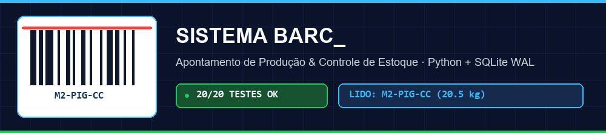
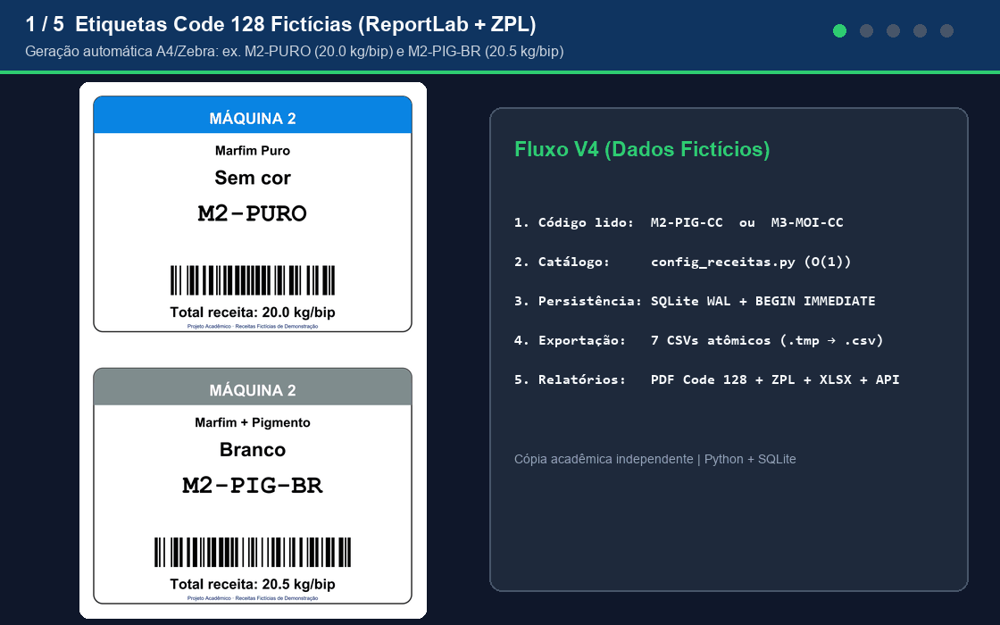
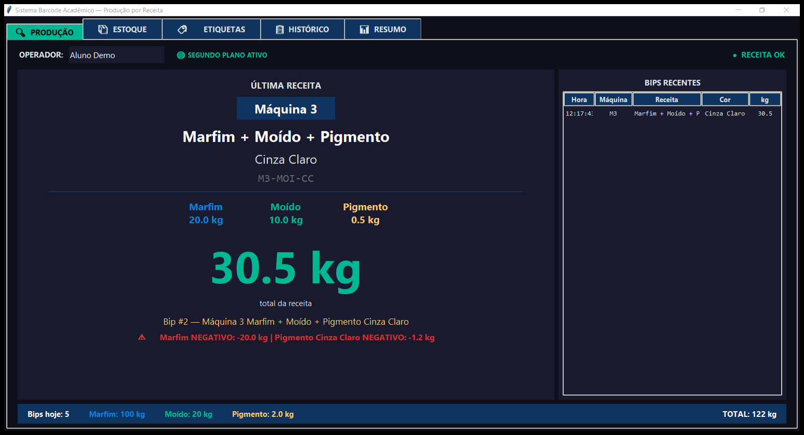
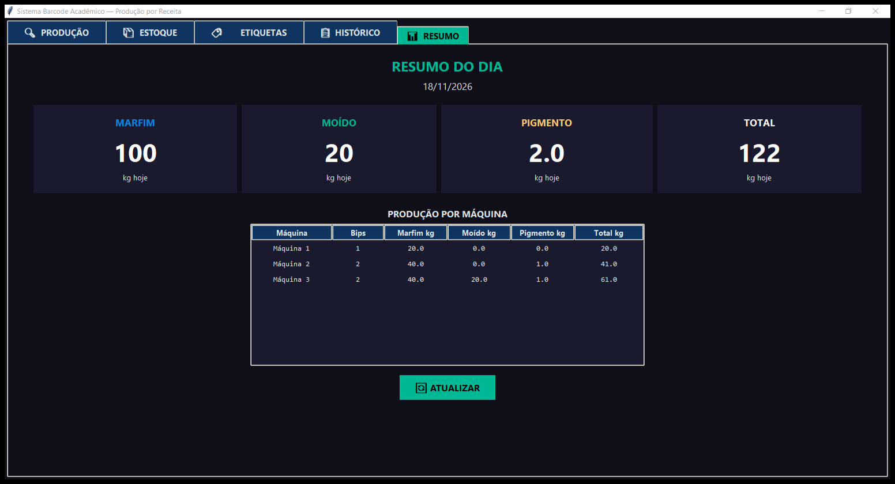

<div align="center">



# Barcode Python Acadêmico (V4)

**Sistema modular em Python + SQLite (WAL) para apontamento de produção e controle de estoque por leitura de código de barras Code 128 — edição acadêmica independente.**

<p>
  <a href="https://github.com/HSHAKOA/barcode-python-academico/actions/workflows/tests.yml"></a>
  <a href="certificacao/CERTIFICADO_VALIDACAO.md"></a>
  <a href="CONTRIBUTING.md"></a>
  
  
  
</p>

[Demonstração](#-demonstração-do-fluxo) • [Capturas de Tela](#-capturas-reais-do-sistema) • [Instalação](#-instalação-e-execução) • [Documentação](docs/README.md) • [Contribuição](#-contribuição) • [Certificado Técnico](certificacao/CERTIFICADO_VALIDACAO.md)

</div>

---

## 🎥 Demonstração do Fluxo

<div align="center">
  
</div>

---

## 📸 Capturas Reais do Sistema

Execução real isolada utilizando **exclusivamente receitas fictícias** (`20,0 kg` base, `10,0 kg` moído e `0,5 kg` pigmento; operador `Aluno Demo`; entrada `NF-Ficticia-001`):

| Aba Produção (leitura `M3-MOI-CC`) | Aba Estoque (alerta saldo negativo) |
| :---: | :---: |
|  |  |

| Aba Histórico (5 apontamentos + CSV) | Aba Resumo do Dia (`122 kg` consolidado) |
| :---: | :---: |
|  |  |

<details>
<summary><b>Ver exemplo de etiqueta PDF Code 128 gerada via ReportLab (etiqueta_M2_p1.png)</b></summary>
<p align="center">
  
</p>
</details>

---

## 🎯 Objetivo Acadêmico e Contexto

Cópia acadêmica independente desenvolvida para consulta e avaliação na disciplina **Algoritmos e Linguagem de Programação — Python**, aplicando na prática: manipulação de strings, dicionários $O(1)$ e listas declarativas, funções modulares, programação orientada a objetos (`Tkinter`), escrita atômica de arquivos (`CSV` UTF-8 BOM e `ZPL`), *threads* com fila segura e transações concorrentes `SQLite WAL` (`BEGIN IMMEDIATE`).

No processo de extrusão modelado, cada bipagem de etiqueta no formato `{MAQUINA}-{RECEITA}` (ex.: `M2-PIG-CC`) decodifica a receita, grava o apontamento em `producao`, desconta os insumos previstos em `estoque` e registra a auditoria em `mov_estoque` de forma atômica.

> **Aviso de dados fictícios:** Todos os parâmetros em [`PACOTE_MAQUINA_NOVA/config_receitas.py`](PACOTE_MAQUINA_NOVA/config_receitas.py) (`20,0 kg` base Marfim, `10,0 kg` Moído e `0,5 kg` Pigmento nas cores `Branco`, `Cinza Claro`, `Preto` e `Azul`) são **estritamente demonstrativos**, não expondo formulações nem dados operacionais de fábrica.

---

## 🗂️ Estrutura do Repositório

```text
barcode-python-academico/
├── .github/workflows/
│   └── tests.yml                       # CI automatizado (20/20 completo + modo stdlib)
├── assets/                             # GIFs animados e capturas reais exibidas no README
│   ├── banner_academico.gif
│   ├── demo_fluxo_academico.gif
│   ├── tela_01_producao.png ... tela_04_resumo.png
│   └── etiqueta_M2_p1.png
├── certificacao/                       # Certificado de validação e checksums (separado)
│   ├── CERTIFICADO_VALIDACAO.md        # Evidências de auditoria, testes e CI
│   ├── certificado_validacao_v4.png    # Certificado técnico visual V4.0
│   └── SHA256SUMS.txt                  # Assinaturas SHA-256 dos artefatos
├── docs/                               # Documentação técnica e didática detalhada
│   ├── README.md                       # Índice dos 7 guias de engenharia e algoritmos
│   └── ...
├── PACOTE_MAQUINA_NOVA/                # Aplicação Python modular + 11 scripts Windows
│   ├── config_receitas.py              # Catálogo fictício demonstrativo
│   ├── core_vtc.py                     # Regras de negócio e persistência SQLite WAL
│   ├── etiquetas_vtc.py                # Etiquetas PDF (Code 128) e térmicas ZPL
│   ├── scanner_vtc.py                  # Captura HID em segundo plano + janela 0,8 s
│   ├── barcode_vtc.py                  # Interface gráfica Tkinter (5 abas)
│   ├── api_vtc.py                      # API FastAPI local opcional (127.0.0.1:8765)
│   ├── exportador_csv.py               # Exportação contínua atômica para 7 CSVs
│   ├── criar_planilha_pq.py            # Gerador da planilha RELATORIO_VTC_PQ.xlsx
│   ├── verificar_dados.py              # Inspeção rápida via CLI
│   ├── requirements.txt                # keyboard, reportlab, openpyxl, fastapi, uvicorn
│   ├── COMO_CONFIGURAR_POWER_QUERY.md
│   └── [11 scripts Windows .bat/.vbs]
├── tests/
│   └── test_barcode_regressao.py       # 20 testes automatizados isolados (unittest)
├── .gitignore                          # Bloqueia .db*, .env*, .venv/, logs e saídas geradas
├── CONTRIBUTING.md                     # Diretrizes de contribuição acadêmica e Pull Requests
├── README.md                           # Visão geral do projeto
└── SECURITY.md                         # Política de sanitização e controles locais
```

---

## 🚀 Instalação e Execução

Recomendado Python **`3.10` a `3.15`** com `tkinter` habilitado:

```powershell
python -m venv .venv
.venv\Scripts\activate
pip install -r PACOTE_MAQUINA_NOVA\requirements.txt
```

No diretório `PACOTE_MAQUINA_NOVA/`:

- **Interface gráfica principal:** `python barcode_vtc.py` (ou `INICIAR_VTC_BARCODE.bat`)
- **Exportador contínuo de CSVs:** `python exportador_csv.py` (ou `INICIAR_EXPORTADOR_CSV.bat`)
- **Planilha Power Query (`.xlsx`):** `python criar_planilha_pq.py`
- **Verificador rápido CLI:** `python verificar_dados.py` (ou `VERIFICAR_DADOS.bat`)
- **API HTTP local opcional (`127.0.0.1:8765`):**
  ```powershell
  $env:VTC_API_KEY="defina-uma-chave-forte-aqui"
  .\INICIAR_API_VTC.bat
  ```

*(O núcleo SQLite, a GUI Tkinter em modo janela, o gerador ZPL, o exportador CSV e o verificador CLI também funcionam apenas com a biblioteca padrão do Python.)*

---

## 🧪 Demonstração Rápida e Testes

### Demonstração na interface gráfica (dados fictícios)
1. Inicie `python barcode_vtc.py` dentro de `PACOTE_MAQUINA_NOVA/`.
2. Na aba **Estoque**, dê entrada fictícia de `40` kg de `Marfim` e `0.8` kg de `Pigmento` `Cinza Claro`.
3. Na aba **Produção**, informe `Aluno Demo` em `OPERADOR`, clique fora da caixa de texto e leia/digite rapidamente `M2-PIG-CC` + `Enter` (`20,0 + 0,5 = 20,5 kg`).
4. Repita `M2-PIG-CC` + `Enter` para observar a baixa para `0,0 kg` em `Marfim` e o alerta em vermelho de saldo negativo em `Pigmento Cinza Claro (-0.2 kg)`.

### Suíte automatizada (`unittest`)
```powershell
python -B -m unittest discover -s tests -v
```
- Todos os `20` testes executam isolados em pastas temporárias (`tempfile.mkdtemp()`), validados localmente e via GitHub Actions tanto no ambiente completo (`.venv`: **`20/20 OK`**) quanto sem pacotes externos (`stdlib`: **`16 OK, 4 skipped`**).

---

## 📚 Documentação, Segurança e Certificação

| Recurso | Finalidade | Localização |
| :--- | :--- | :--- |
| **Documentação Técnica** | Arquitetura, algoritmos Python, bibliotecas, instalação e testes | [`docs/README.md`](docs/README.md) |
| **Certificado de Validação** | Atestado técnico V4.0, logs de execução, CI e *checksums* SHA-256 *(em área separada)* | [`certificacao/CERTIFICADO_VALIDACAO.md`](certificacao/CERTIFICADO_VALIDACAO.md) |
| **Guia de Contribuição** | Padrões PEP 8, regras de dados fictícios e checklist para *Pull Requests* | [`CONTRIBUTING.md`](CONTRIBUTING.md) |
| **Segurança e Sigilo** | Critérios de sanitização, proteção SQLite e bind local da API | [`SECURITY.md`](SECURITY.md) |
| **Versão Empacotada** | Pacote ZIP oficial correspondente à tag `v4.0-academico` | [Releases](https://github.com/HSHAKOA/barcode-python-academico/releases) |

---

## 🤝 Contribuição

Contribuições educacionais, correções de documentação e melhorias na cobertura de testes são muito bem-vindas! Antes de abrir um *Pull Request*:

1. Siga as instruções e regras de sanitização descritas em [`CONTRIBUTING.md`](CONTRIBUTING.md) (nunca envie receitas reais de fábrica, arquivos `.db` ou credenciais).
2. Execute `python -B -m unittest discover -s tests -v` e garanta aprovação integral antes do *push*.

---

## ⚠️ Limitações e Aviso de Independência

- **Limitações conhecidas:** leitor USB HID físico e impressora térmica Zebra não são acionados fisicamente pela suíte automatizada (fluxos verificados via geração ZPL/PDF, hook simulado e fila); atualização ao vivo no Excel via Power Query requer vínculo manual; os cálculos representam valores nominais teóricos por receita; scripts `CONFIGURAR_INICIO_AUTOMATICO*.bat` não devem ser usados em computadores compartilhados de laboratório.
- **Independência e licenciamento:** este repositório é uma **cópia acadêmica independente** derivada da arquitetura original (concebida com auxílio inicial de ferramentas de IA e auditada/refatorada/testada para fins educacionais). **Não é um produto oficial nem mantido pela VTC** e não declara licença *open-source* sem autorização expressa do titular dos direitos.
