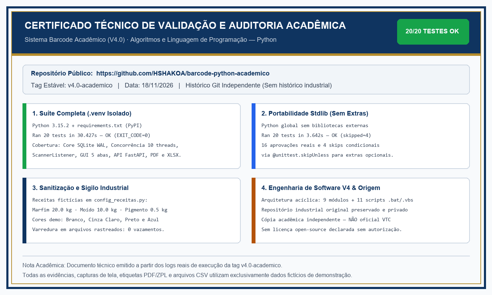

# Certificado Técnico de Validação e Auditoria Acadêmica — V4.0

> Documento **separado do `README.md`**, dedicado exclusivamente à comprovação técnica, auditoria de sanitização e rastreabilidade dos testes do repositório **`HSHAKOA/barcode-python-academico`**.

  

---

## 1. Escopo da Certificação

- **Projeto:** Sistema Barcode Acadêmico (`v4.0-academico`)
- **Disciplina:** Algoritmos e Linguagem de Programação — Python (2º semestre de 2026)
- **Repositório público:** [https://github.com/HSHAKOA/barcode-python-academico](https://github.com/HSHAKOA/barcode-python-academico)
- **Natureza:** Cópia acadêmica independente, sem histórico Git industrial importado e **sem vínculo oficial ou manutenção pela VTC**.

---

## 2. Evidências Automatizadas e Portabilidade

| Ambiente Verificado | Comando Executado | Resultado Comprovado | Cobertura |
| :--- | :--- | :--- | :--- |
| **GitHub Actions CI (`.venv` completo)** | `python -B -m unittest discover -s tests -v` | **`20/20` OK** (`windows-latest`, Python `3.12`) | Core SQLite WAL, concorrência 10 threads, HID `ScannerListener`, GUI 5 abas, API FastAPI/Uvicorn, PDF ReportLab, XLSX OpenPyXL e 11 scripts Windows |
| **Extração limpa local (`.venv`)** | `python -B -m unittest discover -s tests -v` | **`Ran 20 tests in 30.427s — OK`** (`Python 3.15.2`) | Instalação limpa via `PACOTE_MAQUINA_NOVA/requirements.txt` |
| **Somente Biblioteca Padrão (`stdlib`)** | `python -B -m unittest discover -s tests -v` | **`Ran 20 tests — OK (skipped=4)`** (GitHub Actions CI + local) | Núcleo completo, GUI Tkinter, ZPL, CSV atômico, `verificar_dados.py` e portabilidade dos scripts sem pacotes PyPI externos |

- **Workflow verificável no GitHub Actions:** [`.github/workflows/tests.yml`](../.github/workflows/tests.yml)

---

## 3. Auditoria de Sanitização e Confidencialidade

1. **Parâmetros demonstrativos fictícios (`PACOTE_MAQUINA_NOVA/config_receitas.py`):**
   - `MARFIM_KG_POR_BIP = 20.0`
   - `moido_kg = 10.0`, `pigmento_kg = 0.5`
   - Cores demonstrativas: `Branco`, `Cinza Claro`, `Preto`, `Azul`
2. **Isolamento de repositório e dados operacionais:**
   - Bancos `*.db*`, arquivos `.env*`, saídas `dados_powerquery/`, `*.csv`, `*.xlsx`, `*.pdf` e `*.zpl` bloqueados por [`.gitignore`](../.gitignore).
   - O repositório industrial original (`HSHAKOA/sistema-barcode-vtc`) permaneceu **inalterado e privado**.
   - Consulte [`SECURITY.md`](../SECURITY.md) para detalhes sobre controles de segurança local e reporte.

---

## 4. Integridade Criptográfica dos Arquivos

Os *checksums* SHA-256 individuais de todos os módulos Python, scripts Windows, documentação e suíte de testes estão registrados em [`SHA256SUMS.txt`](SHA256SUMS.txt). Os pacotes distribuíveis correspondentes acompanham a **Release `v4.0-academico`** no GitHub.
