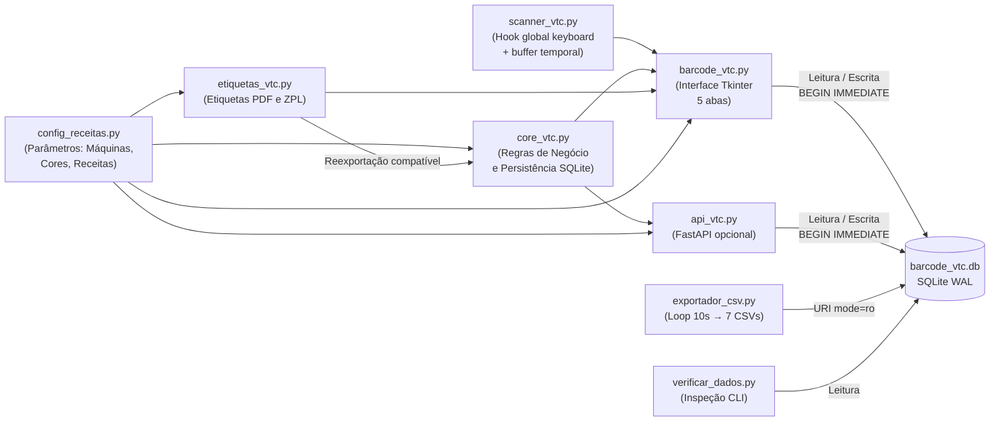

# Arquitetura do Sistema Barcode VTC (v4)

## 1. Diagrama de Módulos e Dependências

A árvore de dependências forma um grafo acíclico dirigido (sem imports circulares): `config_receitas.py` e `scanner_vtc.py` estão na base; `etiquetas_vtc.py` e `core_vtc.py` dependem da configuração; `barcode_vtc.py` e `api_vtc.py` consomem os módulos internos sem conter SQL.

---

## 2. Responsabilidades por Módulo

| Módulo | Responsabilidade Principal | Linhas |
|---|---|---|
| `config_receitas.py` | Catálogo declarativo fictício: `MAQUINAS`, `MARFIM_KG_POR_BIP`, `CORES`, `CORES_HEX`, `RECEITAS`. | 88 |
| `core_vtc.py` | Validação de catálogo e quantidades, decodificação, transações SQLite (`_db`), movimentação de estoque, produção e consultas. Reexporta funções de etiquetas por compatibilidade. | 362 |
| `etiquetas_vtc.py` | Cálculo de total por receita (`calcular_total_receita`), listagem de códigos (`listar_codigos`) e geração de PDF (`reportlab`) e ZPL. | 115 |
| `scanner_vtc.py` | Captura global via `keyboard` em thread separada, filtro de velocidade de leitura (`MAX_SCAN = 0.8s`) e fila `queue.Queue`. | 80 |
| `barcode_vtc.py` | Construção da interface Tkinter (`App`), tabela helper (`_criar_tabela`), fallback de teclado e atualização visual. Reexporta `ScannerListener` e `_char_valido`. | 565 |
| `api_vtc.py` | Endpoints HTTP FastAPI com autenticação `X-API-Key` em tempo constante e recusa explícita de chave padrão. | 132 |
| `exportador_csv.py` | Exportação periódica declarativa (`CONSULTAS_CSV`) de 7 CSVs via `.tmp` + `os.replace()`. | 202 |
| `criar_planilha_pq.py` | Geração do arquivo inicial `RELATORIO_VTC_PQ.xlsx` dividido em `_montar_dashboard` e `_criar_abas_dados`. | 150 |
| `verificar_dados.py` | Script CLI para conferência rápida de contagens, datas e saldos no banco local. | 87 |

---

## 3. Fluxo de Execução

1. **Inicialização (`barcode_vtc.py`):** `core.init_db()` ativa `PRAGMA journal_mode=WAL`, cria as tabelas `producao`, `estoque` e `mov_estoque` (se ausentes) e garante os 9 materiais com saldo inicial `0`. Em seguida `App` inicia `ScannerListener` em thread daemon.
2. **Captura:** se o hook global `keyboard` ativou (`hook_ativo = True`), códigos lidos abaixo de `0.8s` entram em `self.fila` e o fallback Tkinter permanece inativo; caso contrário (`hook_ativo = False`), `<Key>` e `<Return>` na janela capturam o código fora de `tk.Entry`.
3. **Processamento:** `App._processar()` chama `core.decodificar(codigo)` → se válido, chama `core.registrar_producao(info, operador)`, que em uma única transação `BEGIN IMMEDIATE` grava `producao`, desconta os insumos em `estoque`, grava `mov_estoque` e devolve os avisos negativos para a tela.

---

## 4. Banco SQLite e Integrações

- **Esquema preservado (compatível com bancos industriais existentes):** tabelas `producao` (índices `idx_prod_dt` e `idx_prod_maq`), `estoque` (chave primária `(material, cor)`) e `mov_estoque`.
- **Concorrência:** `PRAGMA journal_mode=WAL` permite leituras simultâneas de `exportador_csv.py` (`URI ?mode=ro`), enquanto operações de escrita usam `BEGIN IMMEDIATE` e `PRAGMA busy_timeout = 15000` para serializar atualizações de saldo sem *lost update*.
- **Integrações opcionais:** API FastAPI em `127.0.0.1:8765` (exige `VTC_API_KEY` segura) e exportação CSV contínua em `dados_powerquery/` para atualização automática no Excel via Power Query.

---

## 5. Decisões Arquiteturais Justificadas (v4)

1. **Extração de `scanner_vtc.py`:** retirou lógica de threads e hook do sistema operacional de dentro de `barcode_vtc.py` (691 → 565 linhas), permitindo testar o filtro temporal `ScannerListener._processar_tecla` sem instanciar interface gráfica.
2. **Extração de `etiquetas_vtc.py`:** separou código de desenho PDF (`reportlab`) e comandos térmicos ZPL de `core_vtc.py` (436 → 362 linhas), deixando o núcleo focado apenas em regras de negócio e persistência SQLite.
3. **Preservação de compatibilidade por reexportação:** `core_vtc.py` e `barcode_vtc.py` reexportam os símbolos extraídos, evitando que scripts ou testes existentes quebrem.
4. **Manutenção de `core_vtc.py` sem divisão excessiva:** não separamos `core_vtc.py` em `regras.py` + `repositorio.py` nem criamos padrões como Repository/Factory, pois isso adicionaria camadas artificiais em um projeto de ~360 linhas onde SQL e regra de negócio transacional são mais claros juntos.
